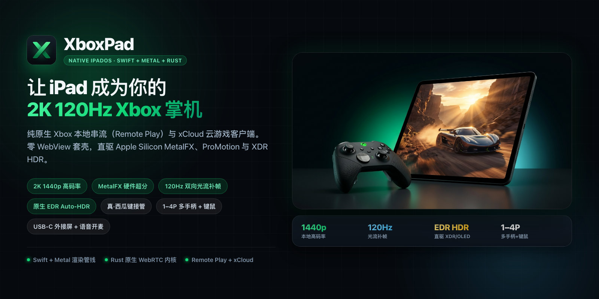
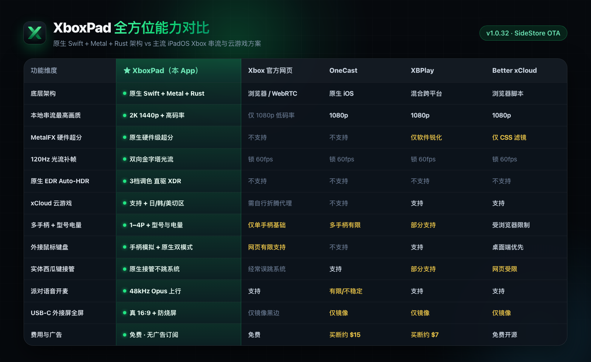
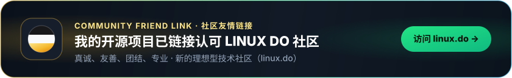

<p align="center">
  
</p>

<h1 align="center">XboxPad</h1>

<p align="center">
  <strong>专为 iPadOS / iPhone (iOS) / macOS 打造的纯原生 2K 120Hz Xbox 本地串流（Remote Play）与云游戏（xCloud）客户端</strong>
</p>

<p align="center">
  <a href="https://xbox.lynkco.site"></a>
  <a href="https://linux.do"></a>
  <a href="LICENSE"></a>
</p>

<p align="center">
  <a href="https://xbox.lynkco.site">官网与介绍页</a> ·
  <a href="sidestore://source?url=https://xbox.lynkco.site/source.json">一键添加到 SideStore</a> ·
  <a href="https://xbox.lynkco.site/source.json">SideStore 订阅源</a> ·
  <a href="#公网穿透与自建-stun--turn-配置指南">自建 STUN / TURN 指南</a> ·
  <a href="https://linux.do">LINUX DO 社区</a>
</p>

---

**XboxPad** 采用 **Swift + Metal 渲染管线 + Rust WebRTC 内核（`RustCore`）** 全链路原生构建，零 WebView / React Native 套壳。针对 Apple Silicon 与 iPad Pro（ProMotion 120Hz / XDR OLED 屏幕）从底层重新打磨，在画质、帧率、操控与扩展体验上全面突破官方网页端限制。

## 核心特性

### 1. 原生 Metal 画质引擎
- **本地串流支持 2K 1440p 高码率**：突破官方移动端默认 1080p 低码率限制，大幅提升画面细节与暗部清晰度。
- **Apple MetalFX 硬件空间超分**：直接调用 `MTLFXSpatialScaler` 硬件管线，低带宽或 1080p 云游戏也能获得锐利纹理。
- **120Hz 双向光流补帧**：自研 Metal 金字塔双向光流 + 前后向遮挡防伪影保护，将 60fps 串流流畅升频至 ProMotion 120Hz。
- **原生 EDR Auto-HDR 调色 + 暗场去色带**：提供自然 / 鲜艳 / 影院三档调色，直驱 iPad Pro XDR / OLED 峰值亮度；内置 8-bit 暗部去色带（Debanding）与机身温控降档保护。

### 2. 主机级操控与外设接管
- **真·实体西瓜键（Xbox Home）接管**：原生 `GCEventViewController` + GameController 底层捕获，配合 iPadOS「主屏幕按钮覆盖」，按下手柄西瓜键直接呼出 Xbox 菜单，告别误跳 Apple Games。
- **1–4P 多手柄同玩 + 型号与电量识别**：支持最多 4 只手柄同时联机，自动识别 Xbox Series / Elite 2、PS5 DualSense / Edge、PS4 DualShock 4、Switch Pro、Joy-Con、Backbone、8BitDo、GameSir 等型号与电量。
- **外接鼠标与键盘双模式**：支持 `GCKeyboard` + `GCMouse` 与指针锁定（`prefersPointerLocked`），提供「手柄模拟（兼容 100% 游戏）」与「原生 Xbox 键鼠」双协议随时切换。
- **深度操控定制**：CoreHaptics 四马达独立震动（握把 + 扳机）、左右摇杆独立死区与响应曲线、陀螺仪体感瞄准、多点触控虚拟手柄。

### 3. 全场景串流生态
- **xCloud 云游戏免折腾**：内置日本 / 韩国 / 美国地区节点切换与自动回退机制，解决非支持区账号无法拉取目录或受地区限制的问题。
- **原生 48kHz Opus 语音开麦**：AudioToolbox 原生编码 Opus 音频上行，串流时可直接开麦与 Xbox 派对/游戏内队友沟通。
- **USB-C / HDMI 外接显示器真 16:9 全屏**：独立外接屏场景无黑边输出，自带 iPad OLED 息屏防烧屏遮罩，并支持 AirPlay 投屏。
- **顺手交互与监控工具**：顶部悬浮控制栏点击画面任意空白即可收起；内置无损截屏直存相册、30 秒双折线延迟监控 HUD、一键刷新关键帧与自动重连。

---

## 与其他 Xbox 串流方案横向对比

<p align="center">
  
</p>

---

## 快速安装

### 方式一：官方下载（iPad / iPhone / macOS）
- **官网介绍页**：**[https://xbox.lynkco.site](https://xbox.lynkco.site)**
- **iPad / iPhone（SideStore 订阅源）**：`https://xbox.lynkco.site/source.json`
- **macOS（Apple Silicon & Intel 通用 `.dmg`）**：直接前往官网下载 `XboxPad-macOS-latest.dmg`，拖入「应用程序」即可使用（首次打开如遇未公证提示，右键点击打开或在终端执行 `xattr -cr /Applications/XboxPad.app`）。

### 方式二：GitHub Actions 自行构建 `.ipa` & `.dmg`（无需本机 Xcode）
1. Fork 本仓库。
2. 进入你的仓库 → **Actions** → 运行 **Build Apple Apps (iOS/iPadOS IPA & macOS DMG)**。
3. 在构建详情页 **Artifacts** 下载纯净开源版 `XboxPad-unsigned-ipa`（iPad/iPhone）与 `XboxPad-macOS-dmg`（macOS）。

### 方式三：本机 Xcode 真机编译
前提：macOS 已安装 Xcode、Rust（`rustup target add aarch64-apple-ios aarch64-apple-ios-sim`）与 XcodeGen（`brew install xcodegen`）。

```bash
# 1. 编译 RustCore XCFramework
./scripts/build-rust-ios.sh

# 2. 生成 Xcode 工程
xcodegen generate

# 3. 打开工程，选择你的 Signing Team 与真机运行
open XboxPad.xcodeproj
```

---

## 公网穿透与自建 STUN / TURN 配置指南

> **隐私与开源说明**：本 GitHub 开源源码与默认 CI 构建**不包含任何开发者私有中继服务器地址或凭据**。
> 局域网直连及常规公网环境默认使用标准公开 STUN 服务器进行 P2P 打洞；如果你的家庭宽带或移动网络处于对称型 / 严格 NAT，需要中继穿透时，可在 App 内手动填写你自己的 STUN / TURN 服务器（官网 SideStore 订阅源版则会通过加密构建环境变量注入官方加速节点）。

### 在 App 内手动配置
1. 打开 XboxPad → **设置 → 区服与网络 → 自定义 STUN / TURN 中继服务器（可选）**。
2. 填写服务器地址：
   - 单节点：`turn:your-server.example:3478` 或 `stun:your-server.example:3478`
   - 多节点（英文逗号分隔）：`turn:node1.example:3478,turn:node2.example:3478`
3. 若使用 TURN 中继，填写对应的 **用户名** 和 **密码（Credential）**；填写 `turn:` 时客户端会自动同时注册同地址的 `stun:` 用于优先 P2P 打洞，只有在无法直连时才会走中继流量。

### 自建 `coturn` 最小配置示例（Ubuntu / Debian）

```bash
sudo apt update && sudo apt install -y coturn
```

编辑 `/etc/turnserver.conf`：

```ini
listening-port=3478
fingerprint
lt-cred-mech
realm=your-server.example
user=your_username:your_strong_password
no-multicast-peers
no-loopback-peers
```

放行防火墙 **UDP/TCP `3478`** 及中继端口段（默认 UDP `49152-65535`），启动服务即可：

```bash
sudo systemctl enable --now coturn
```

---

## 小贴士：开启实体手柄西瓜键（Xbox Home）接管

连接手柄后，前往 iPadOS **设置 → 通用 → 游戏手柄 → 主屏幕按钮**，开启 **「主屏幕按钮覆盖」**，串流时按下手柄西瓜键即可直接呼出 Xbox 主机菜单，不再误跳 Apple Games。

---

## 友情链接 · 社区认可

<p align="center">
  <a href="https://linux.do" target="_blank" rel="noopener">
    
  </a>
</p>

<p align="center">
  我的开源项目已链接认可 <a href="https://linux.do"><strong>LINUX DO 社区</strong></a> —— 新的理想型社区（真诚、友善、团结、专业）。
</p>

---

## 开源协议与致谢

本项目的 `RustCore` 基于 AGPL-3.0 协议的 [Geocld/XStreaming](https://github.com/Geocld/XStreaming) (`nano-rs`) 改编与扩展，整体遵循 **AGPL-3.0** 协议（详见 [LICENSE](LICENSE) 与 [NOTICE](NOTICE)）。
